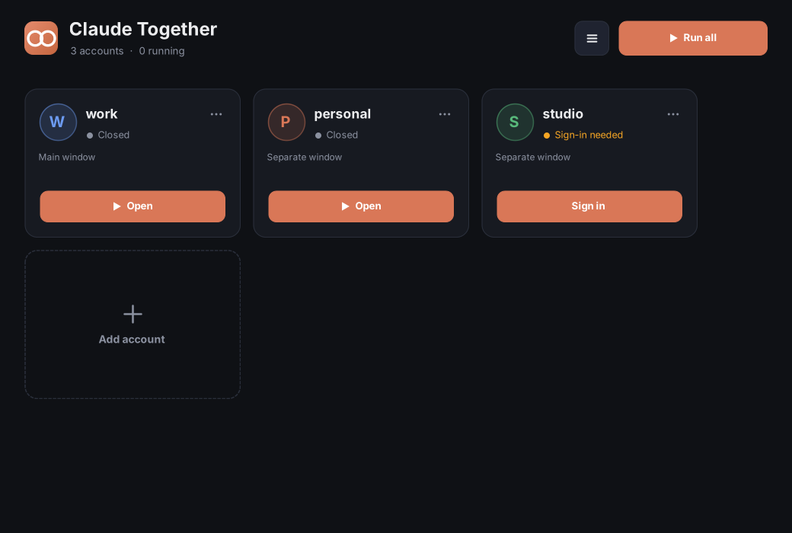
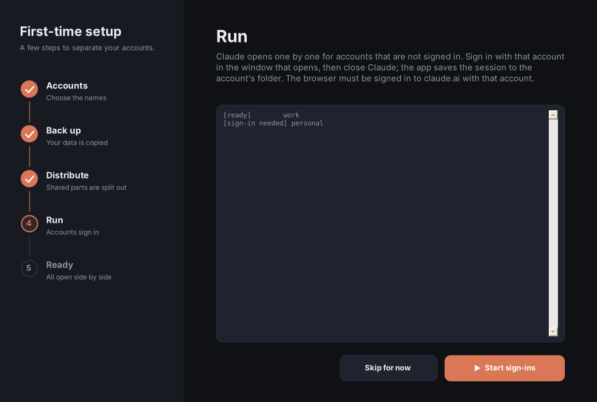

<div align="center">

# Claude Together

**Run several Claude accounts side by side on one Windows PC. Own window, own sign-in, shared settings.**

🌐 **English** · [Türkçe](readme-locals/README.tr.md)

[](LICENSE)

-lightgrey)




</div>

> **Intended use**
> This app is designed solely so that people can use different sessions on their personal computers at the same time, with human input.
> It is explicitly **not** meant for automation of any kind, neither remote nor local, and it does not share any data with the outside.

## Why

Claude Desktop keeps one sign-in per Windows user. If you use a work and a personal account, you sign out and in all day, and an interrupted sign-out can leave your data in a confusing state.

Claude Together gives each account its own Claude Desktop window and its own sign-in, while the parts you want in common (settings, `CLAUDE.md`, skills, plugins, conversation history) are shared.

## Features

- **One click per account**, or **Run all**, from a small dark GUI. Add accounts with **+**.
- **Guided first-time setup**: Back up → Distribute → Run → Ready. Nothing is deleted.
- **Shared by default**: settings, `CLAUDE.md`, skills, plugins, commands, agents, hooks, history. Sign-in stays per account.
- **Command line too**: `claude-together list`, `open`, `login`, `run`, and more, for people who prefer a terminal.
- **Safe**: every sign-in is wrapped in a recoverable step; an interrupted one is rolled back on the next start.
- **No install needed**: two small `.exe` files. No admin rights. No dependencies. Turkish and English UI.

<details>
<summary>Screenshot of the setup wizard</summary>
<br>

</details>

## Get it

1. Download `ClaudeTogether.exe` and `claude-together.exe` from the [Releases](../../releases) page, or build them yourself (see [Build](#build)).
2. Double-click **`ClaudeTogether.exe`**. If Windows SmartScreen warns about an unknown publisher, choose **More info → Run anyway**.
3. Optional, for the terminal: run `claude-together install` once. It copies both files to `%LOCALAPPDATA%\Programs\ClaudeTogether`, adds that folder to your user `PATH` and adds a Start Menu shortcut. No admin rights needed.

## Quick start (GUI)

1. Open **Claude Together**. On first launch the wizard appears.
2. **Accounts**: name the account that is signed in to Claude right now (it keeps the normal Claude window) and the second account.
3. **Back up**: your current data is copied to backup folders. Claude Desktop is closed for this.
4. **Distribute**: shared parts are gathered in one folder and linked into every account.
5. **Run**: Claude opens for the second account. Sign in there, then quit Claude from the tray icon. The session is saved for that account.
6. **Ready**: open the accounts one by one or all at once. Add more accounts any time with the **+** tile.

## Quick start (command line)

```bat
claude-together setup work personal     :: back up and share common data; "work" is signed in right now
claude-together login personal          :: sign in to the second account
claude-together open --all              :: start Claude Desktop for every account
claude-together list                    :: who is signed in, who is running
claude-together run work -- claude      :: Claude Code in this terminal with the "work" account
```

### Commands

| Command | What it does |
| --- | --- |
| `ui` | Open the graphical app |
| `setup <primary> [<other>...]` | First-time setup: back up, then share common data. `<primary>` is the account signed in to Claude Desktop right now |
| `list` | Show accounts: mode, sign-in state, running state (`--json` for scripts you run yourself) |
| `add <name>` | Add an account, then run `login <name>` |
| `remove <name>` | Remove an account from the list (its data is kept) |
| `login <name>` | Sign in to an account in Claude Desktop |
| `open [<name>...] [--all]` | Start Claude Desktop for accounts, or bring it to front if already running |
| `close [<name>...] [--all]` | Stop Claude Desktop for accounts |
| `run <name> [-- <command>]` | Run a command with the account's Claude Code config folder (default command: `claude`) |
| `env <name>` | Print the account's environment (`--shell cmd\|powershell\|json`) |
| `backup` | Copy current Claude data to backup folders |
| `recover` | Restore data parked by an interrupted login |
| `install` / `uninstall` | Per-user install: PATH and Start Menu shortcut |
| `version`, `help` | |

| Option | Meaning |
| --- | --- |
| `-y`, `--yes` | Skip confirmations (Claude Desktop is closed when a command needs that) |
| `--all` | Apply to every account (`open`, `close`) |
| `--json` | JSON output for `list` |
| `--shell cmd\|powershell\|json` | Output format of `env` (default `cmd`) |
| `--lang en\|tr` | Message language. Default: Windows display language, or the `CLAUDE_TOGETHER_LANG` variable |

Exit codes: `0` ok · `1` error · `2` usage error · `3` action needed (for example an account has to sign in).

## How it works

```
%USERPROFILE%\.claude-shared\            shared: projects, skills, plugins, settings.json, CLAUDE.md, ...
%USERPROFILE%\.claude-<account>\         one Claude Code config folder per account (links into the shared folder)
%APPDATA%\Claude\                        Claude Desktop data of the primary account (the normal window)
%APPDATA%\Claude-<account>\              Claude Desktop data of every other account
%APPDATA%\claude-together\               this app: profiles.json, app.log
```

- **Separate windows.** Claude Desktop is an Electron app. A second window with its own sign-in is started with `--user-data-dir`, and every account's Claude Code uses its own `CLAUDE_CONFIG_DIR`.
- **Sharing.** Folders are shared with directory junctions, files with symbolic links (hard links or copies as fallback). No admin rights are needed; Windows Developer Mode makes file links more reliable.
- **Why a "login station"?** After you sign in in the browser, Claude opens through a `claude://` link, and Windows always hands that link to the *normal* Claude window. A second window therefore cannot finish a sign-in itself. To work around this, Claude Together parks the normal data folder, opens a clean Claude, lets you sign in, copies the result to the account's own folder and puts the parked data back. If the app is interrupted in between, the next start restores everything.
- **Your data is never deleted.** Folders set aside get a suffix: `.backup-…`, `.old-…`, `.parked-…`, `.station-…`, `.pre-share-…`; the full backup is `%USERPROFILE%\claude-backup-<time>`. Delete them yourself once you are happy.

## Limitations

- Windows 10/11 only. Needs the Claude Desktop app. macOS and Linux are untested (see [below](#macos-and-linux-untested-help-wanted)).
- All Claude windows share one name and icon in the taskbar.
- Cowork's virtual machine runs for one window at a time.
- Signing in needs the browser to be signed in to claude.ai with the account you are adding. Signing in to another account in the browser first is the usual cause of "wrong account".
- Signing in or refreshing a session closes all Claude Desktop windows for a moment.
- Unofficial. Not affiliated with or endorsed by Anthropic; "Claude" is a trademark of Anthropic. Using several accounts must follow the terms that apply to your accounts. That is your responsibility.

## macOS and Linux: untested, help wanted

Claude Together has only been written and tried on Windows 10/11. I have **not** tested it on macOS or any Linux shell, and I am looking for people who can help there.

- The Windows-specific parts (WMI process detection, `mklink` junctions, robocopy, the Appx lookup, the `install` step) will not work on those systems as they are.
- The core ideas (`CLAUDE_CONFIG_DIR`, `--user-data-dir`, the login station) may carry over, so a port looks possible. Credential storage differs on macOS, which needs checking.
- The build and the core tests run under Mono on Linux, but they only cover file logic with a stubbed shell. The app itself has not been run there.

If you use macOS or Linux and want to help, please try it and open an issue with what you saw, or send a pull request. The same intended use applies to any port: personal computers, human input, no automation.

## Privacy

Everything stays on your computer. The code contains no network access. It reads and writes the folders listed above and writes a local log, `%APPDATA%\claude-together\app.log`. To start Claude Desktop it looks up the install folder with a local PowerShell query (`Get-AppxPackage`).

## Build

You need nothing but Windows. The C# compiler that ships with .NET Framework builds it (C# 5, no packages):

```bat
build.cmd
```

This creates `bin\ClaudeTogether.exe` (windowed) and `bin\claude-together.exe` (console) from the same sources. On Linux or macOS with Mono, `sh build.sh` builds the same files, and `sh tests/run.sh` runs the core tests.

```
src/        Program.cs, Cli.cs, Installer.cs, Localization.cs
src/Core/   paths, config, backup, sharing, process and sign-in logic (no UI)
src/Ui/     WinForms screens and controls
tests/      core tests (Mono)
assets/     app icon
```

Translations live in `src/Localization.cs`: English text is the key, Turkish the value.

## Contributing

Issues and pull requests are welcome. Please read [AGENTS.md](AGENTS.md) first; it lists the conventions for people and AI assistants alike. Keep the copyright header at the top of every source file.

## License

[MIT](LICENSE) © 2026 Rıdvan Gonca. Use it for private or commercial purposes, modify it and share it. Keep the copyright notice (the name "Rıdvan Gonca") in the source files and in the license text.
