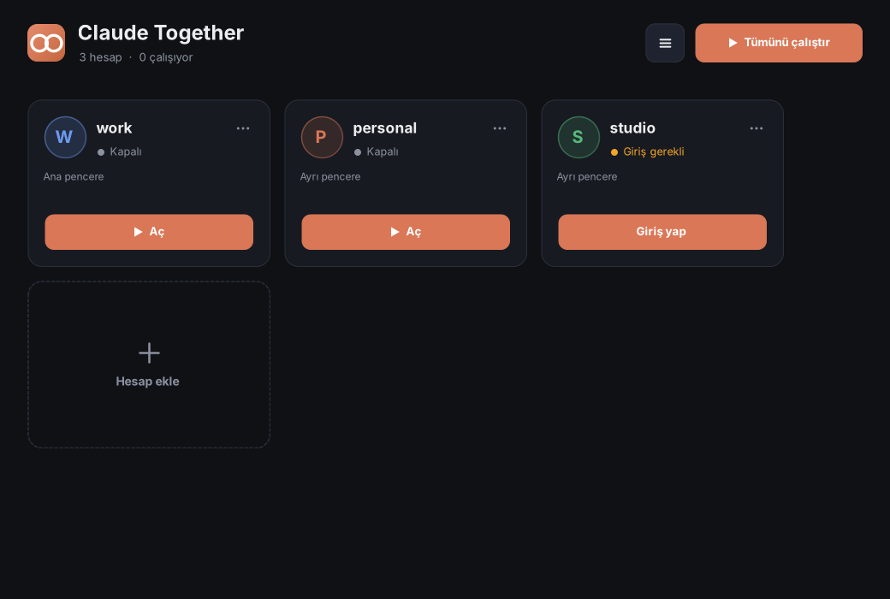
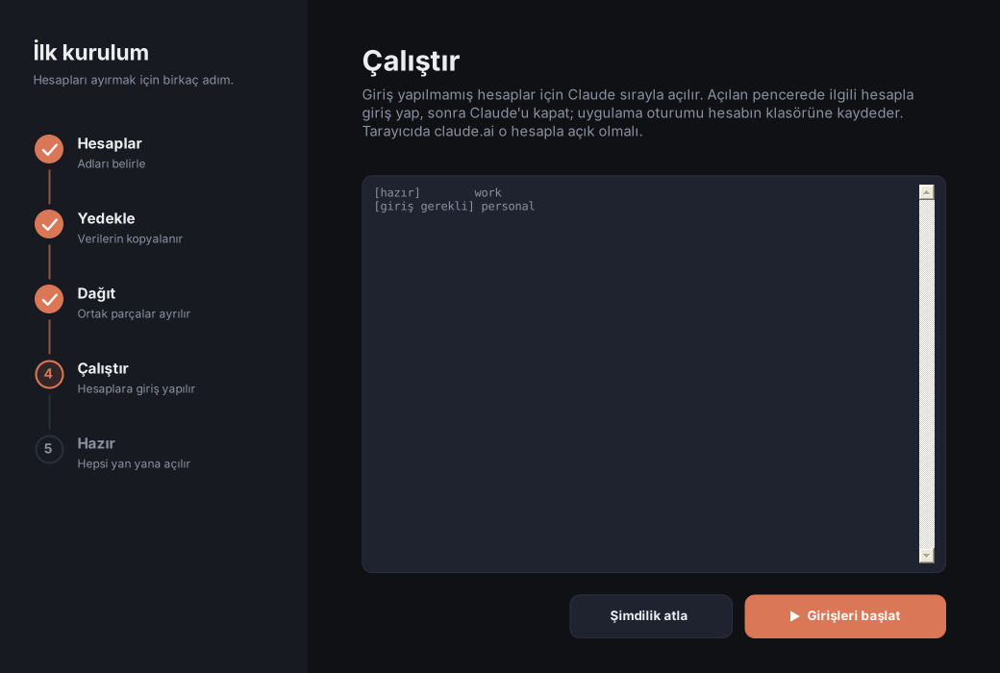

<div align="center">

# Claude Together

**Tek Windows bilgisayarda birden fazla Claude hesabını yan yana çalıştırın. Ayrı pencere, ayrı giriş, ortak ayarlar.**

🌐 [English](../README.md) · **Türkçe**

[](../LICENSE)

-lightgrey)




</div>

> **Kullanım amacı**
> Bu uygulama tamamen kişisel bilgisayarlarda farklı oturumlarda aynı anda insan girdileri ile çalışabilmek için tasarlanmıştır.
> Kesinlikle uzaktan veya lokal üzerinden otomasyon amacı taşımamakta, dışarıya herhangi bir veri paylaşmamaktadır.

## Neden

Claude Masaüstü, Windows kullanıcısı başına tek bir oturum tutar. İş ve kişisel hesabınız varsa gün boyu çıkış yapıp giriş yaparsınız. Yarım kalan bir çıkış da verilerinizi karışık bir durumda bırakabilir.

Claude Together her hesaba kendi Claude Masaüstü penceresini ve kendi girişini verir. Ortak olmasını istediğiniz parçalar (ayarlar, `CLAUDE.md`, skill'ler, eklentiler, konuşma geçmişi) paylaşılır.

## Özellikler

- Küçük, koyu temalı bir arayüzde **hesap başına tek tık** ya da **Tümünü çalıştır**. **+** ile hesap ekleyin.
- **Adım adım ilk kurulum**: Yedekle → Dağıt → Çalıştır → Hazır. Hiçbir şey silinmez.
- **Varsayılan olarak ortak**: ayarlar, `CLAUDE.md`, skill'ler, eklentiler, komutlar, ajanlar, hook'lar, geçmiş. Giriş bilgisi hesaba özel kalır.
- **Komut satırı da var**: terminali sevenler için `claude-together list`, `open`, `login`, `run` ve daha fazlası.
- **Güvenli**: her giriş geri alınabilir bir adımla sarılıdır. Yarım kalan işlem bir sonraki açılışta geri alınır.
- **Kurulum gerektirmez**: iki küçük `.exe`. Yönetici hakkı yok, bağımlılık yok. Arayüz Türkçe ve İngilizce.

<details>
<summary>Kurulum sihirbazının ekran görüntüsü</summary>
<br>

</details>

## İndirme

1. `ClaudeTogether.exe` ve `claude-together.exe` dosyalarını [Releases](https://github.com/RidvanGNC/claude-together/releases) sayfasından indirin ya da kendiniz derleyin ([Derleme](#derleme)).
2. **`ClaudeTogether.exe`** dosyasına çift tıklayın. Windows SmartScreen bilinmeyen yayıncı uyarısı verirse **Ek bilgi → Yine de çalıştır** seçin.
3. Terminal için isteğe bağlı: bir kez `claude-together install` çalıştırın. İki dosyayı `%LOCALAPPDATA%\Programs\ClaudeTogether` klasörüne kopyalar, bu klasörü kullanıcı `PATH`'inize ekler ve Başlat menüsüne kısayol koyar. Yönetici hakkı gerekmez.

## Hızlı başlangıç (arayüz)

1. **Claude Together**'ı açın. İlk açılışta sihirbaz gelir.
2. **Hesaplar**: şu an Claude'a giriş yapılmış hesaba (normal Claude penceresini o kullanır) ve ikinci hesaba ad verin.
3. **Yedekle**: mevcut verileriniz yedek klasörlere kopyalanır. Bunun için Claude Masaüstü kapatılır.
4. **Dağıt**: ortak parçalar tek klasörde toplanır ve her hesaba bağlanır.
5. **Çalıştır**: ikinci hesap için Claude açılır. Orada giriş yapın, sonra Claude'u tepsideki simgeden kapatın. Oturum o hesap için kaydedilir.
6. **Hazır**: hesapları tek tek ya da hepsini birden açın. İstediğiniz zaman **+** kutucuğuyla yeni hesap ekleyin.

## Hızlı başlangıç (komut satırı)

```bat
claude-together setup work personal     :: yedekle ve ortak verileri paylaştır; "work" şu an giriş yapılı hesap
claude-together login personal          :: ikinci hesaba giriş yap
claude-together open --all              :: her hesap için Claude Masaüstü'nü aç
claude-together list                    :: kim giriş yapmış, kim çalışıyor
claude-together run work -- claude      :: bu terminalde "work" hesabıyla Claude Code
```

### Komutlar

| Komut | Ne yapar |
| --- | --- |
| `ui` | Grafik arayüzü açar |
| `setup <ana> [<diğer>...]` | İlk kurulum: yedekler, sonra ortak verileri paylaştırır. `<ana>` şu an Claude Masaüstü'nde giriş yapılı hesaptır |
| `list` | Hesapları gösterir: mod, giriş durumu, çalışma durumu (`--json` kendi yazdığınız betikler için) |
| `add <ad>` | Hesap ekler, ardından `login <ad>` çalıştırın |
| `remove <ad>` | Hesabı listeden çıkarır (verisi korunur) |
| `login <ad>` | Hesaba Claude Masaüstü'nde giriş yapar |
| `open [<ad>...] [--all]` | Hesaplar için Claude Masaüstü'nü açar, açıksa öne getirir |
| `close [<ad>...] [--all]` | Hesaplar için Claude Masaüstü'nü kapatır |
| `run <ad> [-- <komut>]` | Komutu hesabın Claude Code yapılandırma klasörüyle çalıştırır (varsayılan komut: `claude`) |
| `env <ad>` | Hesabın ortam değişkenlerini yazdırır (`--shell cmd\|powershell\|json`) |
| `backup` | Mevcut Claude verisini yedek klasörlere kopyalar |
| `recover` | Yarım kalan girişin kenara aldığı veriyi geri koyar |
| `install` / `uninstall` | Kullanıcı bazlı kurulum: PATH ve Başlat menüsü kısayolu |
| `version`, `help` | |

| Seçenek | Anlamı |
| --- | --- |
| `-y`, `--yes` | Onayları atlar (gerektiğinde Claude Masaüstü kapatılır) |
| `--all` | Tüm hesaplara uygular (`open`, `close`) |
| `--json` | `list` için JSON çıktısı |
| `--shell cmd\|powershell\|json` | `env` çıktı biçimi (varsayılan `cmd`) |
| `--lang en\|tr` | Mesaj dili. Varsayılan: Windows görüntü dili ya da `CLAUDE_TOGETHER_LANG` değişkeni |

Çıkış kodları: `0` tamam · `1` hata · `2` kullanım hatası · `3` işlem gerekli (örneğin bir hesabın giriş yapması gerekir).

> Komut yardımı (`claude-together help`) İngilizcedir; çalışma sırasındaki mesajlar dil ayarını izler.

## Nasıl çalışır

```
%USERPROFILE%\.claude-shared\            ortak: projects, skills, plugins, settings.json, CLAUDE.md, ...
%USERPROFILE%\.claude-<hesap>\           hesap başına Claude Code klasörü (ortak klasöre bağlantılar içerir)
%APPDATA%\Claude\                        ana hesabın Claude Masaüstü verisi (normal pencere)
%APPDATA%\Claude-<hesap>\                diğer her hesabın Claude Masaüstü verisi
%APPDATA%\claude-together\               bu uygulama: profiles.json, app.log
```

- **Ayrı pencereler.** Claude Masaüstü bir Electron uygulamasıdır. Kendi girişi olan ikinci pencere `--user-data-dir` ile başlatılır; her hesabın Claude Code'u kendi `CLAUDE_CONFIG_DIR` klasörünü kullanır.
- **Paylaşım.** Klasörler dizin bağlantısıyla (junction), dosyalar sembolik bağlantıyla paylaşılır (olmazsa sabit bağlantı ya da kopya). Yönetici hakkı gerekmez; Windows Geliştirici Modu dosya bağlantılarını daha güvenilir yapar.
- **"Giriş istasyonu" neden var?** Tarayıcıda giriş yaptıktan sonra Claude bir `claude://` bağlantısıyla açılır ve Windows bu bağlantıyı her zaman *normal* Claude penceresine verir. İkinci pencere girişi kendi başına tamamlayamaz. Claude Together bunu şöyle aşar: normal veri klasörünü kenara alır, temiz bir Claude açar, girişi yapmanızı bekler, sonucu hesabın kendi klasörüne kopyalar ve kenara alınan veriyi geri koyar. Arada yarıda kalırsa bir sonraki açılış her şeyi geri yükler.
- **Verileriniz asla silinmez.** Kenara alınan klasörler sonek alır: `.backup-…`, `.old-…`, `.parked-…`, `.station-…`, `.pre-share-…`. Tam yedek `%USERPROFILE%\claude-backup-<zaman>` klasörüdür. Memnun kalınca kendiniz silebilirsiniz.

## Sınırlamalar

- Yalnızca Windows 10/11. Claude Masaüstü uygulaması gerekir. macOS ve Linux denenmedi (aşağıya bakın: [macOS ve Linux](#macos-ve-linux-denenmedi-destek-bekliyoruz)).
- Tüm Claude pencereleri görev çubuğunda aynı ad ve simgeyle görünür.
- Cowork'ün sanal makinesi aynı anda tek pencerede çalışır.
- Giriş için tarayıcıda claude.ai, eklediğiniz hesapla açık olmalıdır. "Yanlış hesap" sorununun olağan nedeni, tarayıcıda önce başka hesaba giriş yapmış olmaktır.
- Giriş yaparken ya da oturum yenilerken tüm Claude Masaüstü pencereleri kısa süre kapanır.
- Resmî değildir. Anthropic ile bağlantılı değildir ve onun onayını taşımaz; "Claude" Anthropic'in ticari markasıdır. Birden fazla hesap kullanımı hesaplarınız için geçerli koşullara uymalıdır. Bu sizin sorumluluğunuzdadır.

## macOS ve Linux: denenmedi, destek bekliyoruz

Claude Together yalnızca Windows 10/11 üzerinde yazıldı ve denendi. macOS'ta ya da herhangi bir Linux kabuğunda **denemedik**; bu alanda destek arıyoruz.

- Windows'a özgü parçalar (WMI ile süreç tespiti, `mklink` bağlantıları, robocopy, Appx sorgusu, `install` adımı) bu sistemlerde olduğu gibi çalışmaz.
- Temel fikirler (`CLAUDE_CONFIG_DIR`, `--user-data-dir`, giriş istasyonu) taşınabilir, yani bir port mümkün görünüyor. macOS'ta kimlik bilgisi saklama farklıdır; bunun ayrıca kontrol edilmesi gerekir.
- Derleme ve çekirdek testler Linux'ta Mono ile çalışır, ama yalnızca dosya mantığını sahte bir kabukla sınar. Uygulamanın kendisi orada çalıştırılmadı.

macOS ya da Linux kullanıyorsanız denemenize ve gördüklerinizi bir issue olarak yazmanıza, ya da pull request göndermenize bekleriz. Her port için aynı kullanım amacı geçerlidir: kişisel bilgisayarlar, insan girdisi, otomasyon yok.

## Gizlilik

Her şey bilgisayarınızda kalır. Kodda ağ erişimi yoktur. Yukarıdaki klasörleri okur ve yazar, yerel bir günlük tutar: `%APPDATA%\claude-together\app.log`. Claude Masaüstü'nü başlatmak için kurulum klasörünü yerel bir PowerShell sorgusuyla (`Get-AppxPackage`) bulur.

## Derleme

Windows'tan başka bir şeye ihtiyacınız yok. .NET Framework ile gelen C# derleyicisi yeterlidir (C# 5, paket yok):

```bat
build.cmd
```

Aynı kaynaklardan `bin\ClaudeTogether.exe` (pencereli) ve `bin\claude-together.exe` (konsol) üretilir. Linux ya da macOS'ta Mono ile `sh build.sh` aynı dosyaları derler, `sh tests/run.sh` çekirdek testlerini çalıştırır.

```
src/        Program.cs, Cli.cs, Installer.cs, Localization.cs
src/Core/   yollar, yapılandırma, yedek, paylaşım, süreç ve giriş mantığı (arayüzsüz)
src/Ui/     WinForms ekranları ve denetimleri
tests/      çekirdek testleri (Mono)
assets/     uygulama simgesi
```

Çeviriler `src/Localization.cs` içindedir: anahtar İngilizce metin, değer Türkçesidir.

## Katkı

Sorunlar ve pull request'ler memnuniyetle karşılanır. Önce [AGENTS.md](../AGENTS.md) dosyasını okuyun; hem insanlar hem yapay zekâ asistanları için kuralları içerir. Her kaynak dosyanın başındaki telif başlığını koruyun.

## Lisans

[MIT](../LICENSE) © 2026 Rıdvan Gonca. Özel ya da ticari amaçla kullanabilir, değiştirebilir ve paylaşabilirsiniz. Telif bildirimini ("Rıdvan Gonca" adı) kaynak dosyalarda ve lisans metninde koruyun.
